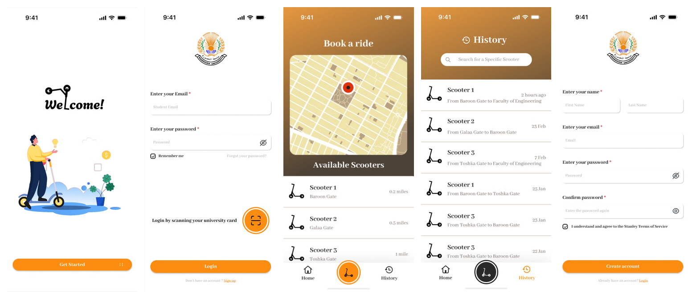
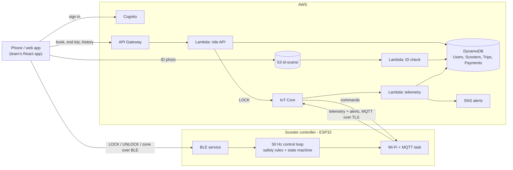
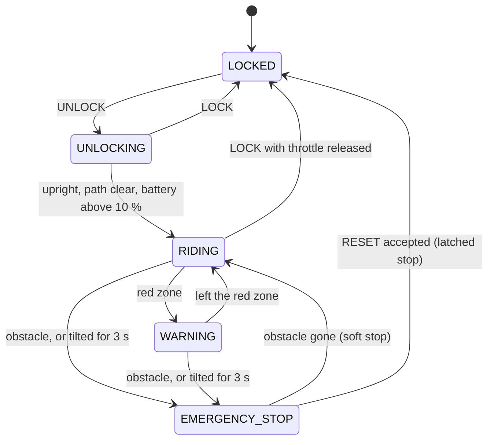
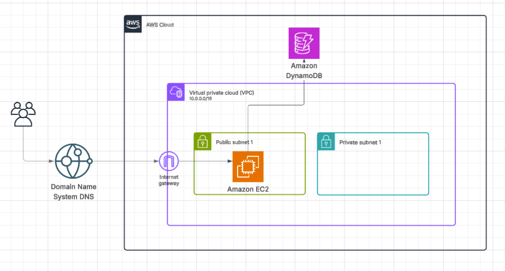
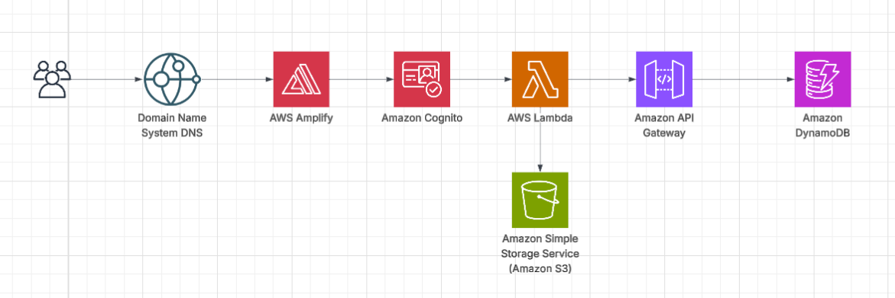

# campus-scooter-rental

An electric-scooter rental system for a closed campus: students sign up with their university card, find and book a scooter in an app, and ride inside zones the campus allows. This repository holds the two parts closest to the hardware and the cloud: the **ESP32 scooter controller** (a safety state machine with BLE and MQTT links) and the **AWS serverless back end** (as CDK code). It started as a B.Sc. graduation project at Mansoura University ("Smart Electric Scooter Rental System for Enclosed Areas", 2025/2026), built by a student team.



*App design by the project team (Figma), from the project book. The app itself is not in this repository.*

## Where this code comes from

The project was never kept in a public repository, and most of its original code is gone. What is here is a **2026 rewrite**, built from three sources:

| Source | What it gave |
|---|---|
| A surviving prototype sketch (file date 25 January 2026), kept unchanged in [`firmware/original/`](firmware/original/) | The ride state machine, safety rules, throttle ramp, sensor filters, display texts and BLE service. These were ported, not reinvented. |
| The final project book (2025/2026), chapters 6 to 9 | The hardware description, the MQTT topic tree and message format, and the design ideas the sketch does not contain (Wi-Fi telemetry, reconnect back-off, store-and-forward). |
| The first project book (2025), chapters 17 to 21 | The data model, the ride lifecycle, the ID-check idea and the two-phase AWS design with its console screenshots. |

So that nothing is overstated:

- **Nothing in this repository has been run on the prototype.** The firmware compiles for the ESP32 and its logic passes host tests; it has not been flashed. The AWS stack is synthesised and unit-tested; it has not been deployed.
- Parts marked **[new]** in the code (MQTT link, GPS parsing, battery divider, lock servo, watchdog) were not on the built prototype, which was a desk-sized model with an IR sensor, a tilt sensor, a throttle potentiometer, an LCD, a buzzer and small motors.
- The app, its design and the Node.js API were other team members' work. They are described and credited here, not recreated. See [docs/TEAM.md](docs/TEAM.md).
- There are no measurements from the original hardware in this repository.

## How the parts connect



The phone talks to the scooter directly over BLE because an unlock should not wait for the internet. The scooter reports to the cloud over MQTT, and the cloud can send the same commands back as a second path. More detail: [docs/ARCHITECTURE.md](docs/ARCHITECTURE.md).

## What is in the repository

| Path | Contents |
|---|---|
| `firmware/lib/scooter_core/` | Hardware-free C++: state machine, safety rules, filters, GPS parser, message builders, link helpers. |
| `firmware/src/` | The ESP32 side: sensors, LCD and buzzer, motor and lock, BLE service, Wi-Fi/MQTT task, `main.cpp`. |
| `firmware/include/Config.h` | Every pin and tuning number, each marked `[sketch]`, `[book]` or `[new]`. |
| `firmware/original/` | The surviving prototype sketch, unmodified. |
| `cloud/stacks/` | The AWS stack (CDK, Python): 47 resources. |
| `cloud/lambdas/` | Three handlers: ID check, telemetry ingest, ride API. |
| `cloud/cost.py` | Monthly cost model with unit prices from the AWS price list. |
| `docs/` | Architecture, firmware notes, hardware and pin map, data model, team and credits, book pictures. |

## Run the checks

No board and no AWS account are needed.

```bash
python -m venv .venv && . .venv/bin/activate      # Windows: .venv\Scripts\activate
pip install -r cloud/requirements-dev.txt
python tools/check.py        # same as: make check
python tools/plan.py         # same as: make plan  (lists the resources; deploys nothing)
python cloud/cost.py         # same as: make cost
```

`tools/check.py` compiles and runs the firmware host tests (it needs `g++` or `clang++`; without one, `pip install ziglang` provides a compiler), runs `ruff` and `pytest` on the cloud code, synthesises the stack and runs the cost model. Node.js must be installed for the CDK library. With PlatformIO installed, `cd firmware && pio test -e native` runs the same tests under Unity and `pio run -e esp32dev` builds the firmware (copy `include/secrets.example.h` to `include/secrets.h` first if you want real Wi-Fi and AWS IoT values; without it the build uses the placeholders).

## Firmware

The controller is a five-state machine. Every 20 ms the loop reads the sensors, applies the safety rules, moves the state machine, ramps the motor command and updates the display, in that order.



- **Two kinds of emergency.** An obstacle is a soft stop that ends when the path is clear. A long tilt is latched: it needs an explicit `RESET`, which is refused until the scooter is upright, the throttle is released and it is outside a red zone.
- **Zones.** `SLOW` caps the throttle at 50 %. `RED` brings the scooter to a stop over 3 seconds and refuses parking.
- **One writer.** BLE and MQTT callbacks run on other tasks; they only post commands into a small atomic mailbox that the loop empties each tick. Wi-Fi and TLS run in their own task on core 0 so a slow handshake cannot delay the safety loop.

The port fixed four faults found in the sketch (for example a `RESET` sent early would silently cancel a later emergency) and left three known gaps open, all listed in [docs/FIRMWARE.md](docs/FIRMWARE.md). Hardware, parts and pin map: [docs/HARDWARE.md](docs/HARDWARE.md).

## Cloud

The project's cloud work had two phases, both described in the book. Phase 1 put the team's web app on one small EC2 server behind Nginx with HTTPS. Phase 2 replaced the server with managed services; that is the design written as code here.

| Phase 1 (book diagram) | Phase 2 (book diagram) |
|---|---|
|  |  |

The stack in `cloud/` adds what the final book describes for the scooters (IoT Core policy and topic rules) and tightens a few things the 2025 prototype left loose: each Lambda role lists only the actions it uses, ID photos expire after 30 days, and the ID-check function fetches a page only from an allow-listed university host. Details, the phase-1 record and the deployment notes: [cloud/README.md](cloud/README.md). Data model: [docs/DATA_MODEL.md](docs/DATA_MODEL.md).

### Cost estimate

`python cloud/cost.py` prints the monthly cost for an assumed usage pattern (8 rides of 10 minutes per scooter per day, one telemetry record per second while riding and one per 30 s while parked, 20 riders per scooter). Unit prices were read from the AWS Price List API for us-east-1 on 2026-11-15; the usage numbers and Lambda run times are assumptions, because nothing was deployed or measured.

| Fleet | Monthly total | Per scooter | Largest lines |
|---|---|---|---|
| 10 scooters | $4.95 | $0.50 | IoT messages 46 %, DynamoDB writes 29 % |
| 100 scooters | $49.56 | $0.50 | same |
| 1 000 scooters | $647.59 | $0.65 | IoT messages 35 %, Cognito 23 %, DynamoDB writes 22 % |

Almost all of it is telemetry. Reporting every 5 minutes instead of every 30 s while parked takes the 100-scooter figure to $33.64 (`--parked-period 300`). The 12-month and always-free tiers are not subtracted, so a small pilot would pay less than shown.

## What the outputs look like

```text
$ python tools/check.py
== firmware core: run host tests
PASS test_long_tilt_latches_until_reset
PASS test_obstacle_inside_red_zone_stops_and_recovers
...
26 Tests 0 Failures
== cloud: pytest
42 passed
== cloud: synthesise the stack (no AWS access)
Plan: 47 resources would be created (nothing was sent to AWS)
All checks passed.
```

A PlatformIO build with Arduino-ESP32 3.3.11 reports 1 848 520 bytes of flash (94 % of the 1.9 MB app slot) and 75 836 bytes of static RAM.

## Limitations

- Not run on hardware and not deployed. Timing, radio behaviour, TLS memory use and real sensor noise are untested.
- The firmware image nearly fills its flash slot, because Bluetooth and TLS are both large.
- `UNLOCK` over BLE is not authenticated: any phone that connects can send it. The book describes a signed key; it is not implemented.
- The ID-check function needs a barcode library that is not in the Lambda runtime; without it every upload ends as "manual review".
- Listing scooters scans the whole table, and there is no payment code, no admin dashboard and no geofence computation (the zone arrives as a command).
- Battery, GPS and lock-servo code use placeholder constants and were never connected to parts.

## Next steps

See [TODO.md](TODO.md): flash a board and replay the state-machine tests by hand, authenticate the unlock, package the barcode decoder, and replace the scooter scan with an index.

## Team and credits

The project was built by a team of students under faculty supervision. Names and roles, as printed in the two project books, are in [docs/TEAM.md](docs/TEAM.md). Screens and diagrams in `docs/img/` come from those books.

## Licence

MIT, see [LICENSE](LICENSE). The licence covers the code in this repository; the app designs shown in the pictures belong to the project team.
