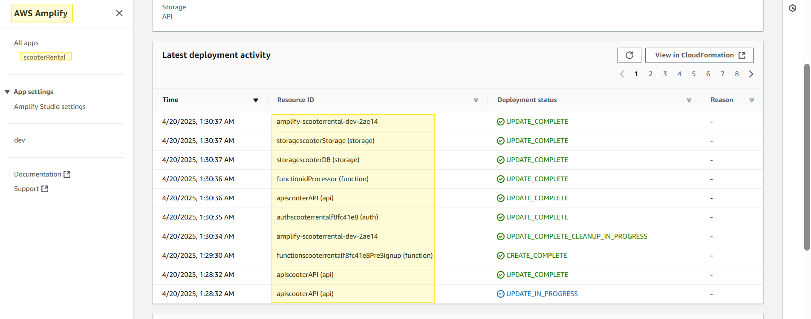
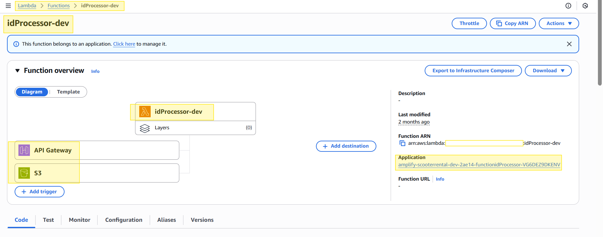

# Cloud

## Phase 1, as it was done in 2025 (documented, not rebuilt)

The first book (ch. 21) records the first deployment, done by hand in the AWS console within the free tier:

- One `t2.micro` EC2 instance, Ubuntu 22.04, in a public subnet of the default VPC in `us-east-1`, with an Elastic IP so its address stayed fixed.
- A security group allowing SSH from one address and HTTP/HTTPS from anywhere; Nginx installed by a user-data script.
- A custom `.xyz` domain bought on a registrar promotion, with an A record pointing at the Elastic IP (TTL 300 s).
- HTTPS from Let's Encrypt: `certbot --nginx` for the domain and its `www` name, renewed by certbot's systemd timer (`certbot renew --dry-run` to test).
- One DynamoDB table for the back-end developer, and an IAM role attached to the instance so the server could reach DynamoDB **without access keys on disk**. The role used the managed full-access policy "for rapid prototyping".
- Node 20 with `express` and `@aws-sdk/client-dynamodb` on the server.

That server, address and domain belonged to the 2025 prototype and are not referenced anywhere in this code.

## Phase 2, as code

The book's second phase replaced the server with managed services. `stacks/scooter_stack.py` writes that design down, plus the scooter side from the final book:

| Service | In the book | In the stack |
|---|---|---|
| Cognito | Sign-up, login, MFA | User pool: e-mail sign-in, e-mail verification, optional TOTP MFA, public web client |
| S3 | Uploaded ID images | Private encrypted bucket; `id-scans/` objects expire after 30 days |
| Lambda | ID processing on S3 upload | `id_processor`, triggered by `id-scans/` uploads |
| DynamoDB | Users and rides | Users, Scooters, Trips, Payments; on-demand, point-in-time recovery |
| API Gateway | Exposes the Lambda endpoints | HTTP API, every route behind the Cognito JWT authorizer, `rides_api` Lambda |
| CloudWatch | Logs and monitoring | 30-day log groups, error alarms on two functions, SNS topic for operators |
| IoT Core | Final book, ch. 9 | One policy for all scooters (confined by thing name), two topic rules, `telemetry_ingest` Lambda |
| Amplify | Hosted the front end | Not in the stack: it would host the team's React app, which is not in this repository |

Screenshots from 2025 show the original, built with the Amplify CLI:





*From the first book, ch. 21. The account menu is cropped; account numbers were already blanked in the book.*

### What is stricter than the 2025 prototype

- **IAM.** The 2025 role had DynamoDB full access. Here each function's role lists the exact actions it calls on the exact tables (a test fails on any wildcard action).
- **ID photos.** They are personal data. The bucket blocks all public access, refuses non-TLS requests, and deletes `id-scans/` objects after 30 days. The function records the student number, college and year on the user's row; it does not copy the name, and the photo itself stays only in the bucket until it expires.
- **The barcode link is untrusted input.** The ID check fetches the page a barcode points to. Without a check, anyone could upload a barcode that makes the function call an internal address. The function only fetches `https` links whose host is in `ALLOWED_ID_HOSTS` (empty by default, so it fetches nothing until the university portal's host is configured).
- **Scooters.** Each device may connect only as itself and publish only under its own id.

## Plan, never deploy

```bash
python tools/plan.py     # or: make plan
```

This synthesises the CloudFormation template into `cloud/cdk.out/` and lists the 47 resources. It needs no AWS account and contacts nothing. The stack has **never been deployed**; nothing in this repository runs `cdk deploy`. To try it in your own account you would install the CDK CLI, run `npx cdk bootstrap` and `npx cdk deploy` yourself, and then, per scooter: create an IoT thing named like its `DEVICE_ID`, create a certificate, attach the certificate to the thing and the stack's policy to the certificate, and copy the certificate, key and account endpoint into `firmware/include/secrets.h`.

Settings (in `cdk.json` or with `-c name=value`): `org_id` (the `{org}` part of the MQTT topics) and `allowed_id_hosts` (comma-separated hosts the ID check may fetch).

## Tests

`pytest` (42 tests) covers: the ID field patterns and decision logic with a made-up page; the telemetry validator and its out-of-order protection; the whole ride lifecycle against in-memory DynamoDB tables (moto), including double booking; the template's security properties; and the arithmetic of the cost model.

## Known gaps

- The barcode decoder (`pyzbar` + Pillow, needing the `zbar` system library) is not packaged. Until it is added as a Lambda layer or container image, every upload is recorded as `manual_review` with reason `decoder_unavailable`. The original 2025 function's code is not available, so how it read the card is not known beyond the book's description.
- `GET /scooters` scans the table.
- No payment processing, no reviews, no admin API.
- Lambda run times in `cost.py` are assumptions.
