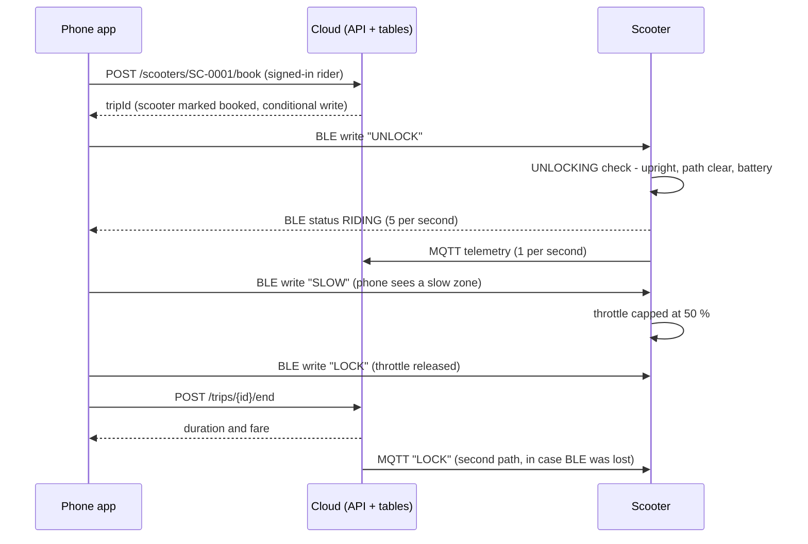

# Architecture

## The three conversations

The system is easiest to understand as three separate conversations, each with its own link and its own reason for using that link.

| Conversation | Link | Why this link |
|---|---|---|
| Rider's phone ↔ scooter | Bluetooth Low Energy | The rider is standing next to the scooter. An unlock or a "slow down" must work at once, even with no internet. |
| Scooter ↔ cloud | MQTT over TLS on Wi-Fi (AWS IoT Core) | Small, frequent messages over a connection that drops. MQTT keeps one session open instead of a new HTTPS handshake per message. |
| Rider's app ↔ cloud | HTTPS (API Gateway), sign-in with Cognito | Ordinary request and response: list scooters, book, end a trip, see history. |

The book chose BLE for the "last metre" and Wi-Fi with MQTT for the backhaul (final book, ch. 9.2 and 9.3); this repository keeps that split.

## A ride, end to end

Who decides what:

- **The scooter decides everything about safety.** Obstacle stops, the tilt latch, ramp rates and "may I unlock now" are computed on the device and work with no network at all. The phone and the cloud can only *ask* (commands are intents that the safety controller may refuse).
- **The phone decides the zone.** It has the better GPS and the map of allowed areas, so it sends `CLEAR`, `SLOW` or `RED` over BLE. The cloud can send the same words over MQTT as a backstop. Computing zones from coordinates is not implemented in this repository.
- **The cloud decides who may ride.** Booking needs a verified account, and the conditional write on the scooter row is what stops two riders from booking one scooter.

## MQTT topics

From the final book (ch. 9.3.1), unchanged:

| Topic | Direction | QoS | Content |
|---|---|---|---|
| `campus/{org}/scooter/{id}/telemetry` | scooter → cloud | 0 | State, zone, throttle, position, battery, signal strength |
| `campus/{org}/alerts/critical` | scooter → cloud | 1 | A latched emergency (`TILT`, ...) |
| `campus/{org}/scooter/{id}/cmd` | cloud → scooter | 1 | `LOCK`, `UNLOCK`, `RESET`, `CLEAR`, `SLOW`, `RED` |

Each scooter connects with its own X.509 certificate, and the IoT policy uses the thing name as a variable, so a scooter can publish only under its own id and receive only its own commands. The telemetry Lambda checks again that the id inside the message matches the topic.

## What runs where on the ESP32

| Core 1 | Core 0 |
|---|---|
| Control loop, 50 Hz: sensors, safety rules, state machine, motor, display | Wi-Fi, TLS, MQTT, GPS serial port (one FreeRTOS task) and the Bluetooth stack |

The two sides share no variables. The control loop publishes a snapshot into a one-slot queue and alerts into a small queue; the other side posts commands into an atomic mailbox. A TLS handshake that takes four seconds therefore costs the safety loop nothing.

## Failure cases the design answers

| What fails | What happens |
|---|---|
| Internet drops during a ride | The ride continues; BLE still works. Telemetry is kept in the outbox (last 32 records) and sent after reconnecting; the cloud ignores records older than what it already has. |
| Phone disconnects | The scooter asks itself to lock (granted only if the throttle is released; see the known gaps in FIRMWARE.md). |
| Control loop hangs | The watchdog resets the chip after 2 s; it boots in `LOCKED` with the motor output low. |
| Accelerometer missing at boot | The firmware carries on without tilt detection and says so on the serial port (as the sketch did). |
| A scooter's certificate is stolen | It can only impersonate that one scooter; the certificate can be revoked in IoT Core without touching the others. |
| The same scooter is booked twice at once | One of the two conditional writes fails and that rider gets "not available". |

## What is not in this repository

The React web app, the Figma design files, the Node.js/Express/MongoDB API and the admin dashboard described in the books. They were other team members' work (see TEAM.md).
