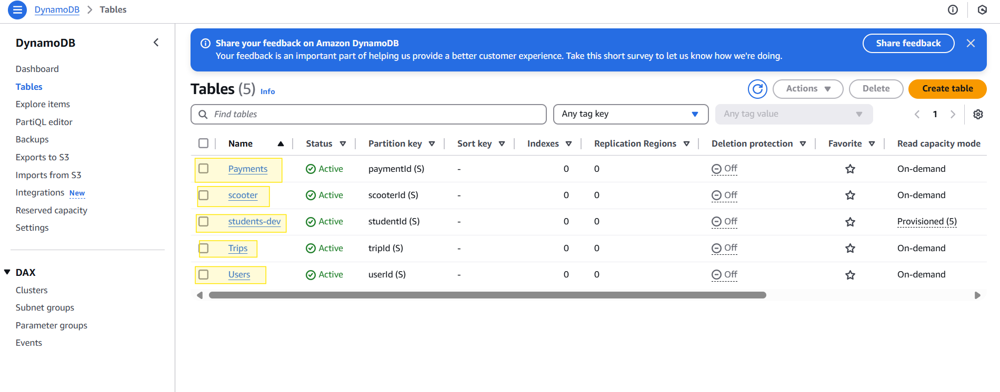

# Data model

## In the book: MongoDB collections

The team's back end (first book, ch. 18) used MongoDB with Mongoose. Its five collections:

| Collection | Key fields | Notes from the book |
|---|---|---|
| Users | firstName, lastName, email, password, studentId, profilePicture, collegeIdImage, accountStatus, resetPasswordToken | Passwords hashed with bcrypt; JWT sign-in |
| Scooters | scooterName, scooterNumber, qrCode, status, batteryLevel, location (GeoJSON Point), bookedBy, currentTrip | 2dsphere index on `location` for "scooters near me"; index on `status` |
| Trips | userId, scooterId, startTime, endTime, startLocation, endLocation (GeoJSON), status, distance, duration, fare, route | Status values ONGOING, COMPLETED, CANCELLED |
| Payments | userId, tripId, amount, currency, paymentMethod, status, transactionId, paymentDetails, refund | One payment per trip |
| Reviews | userId, tripId, rating, comment, issues | Feedback after a ride |

Relationships: one user to many trips, one scooter to many trips, one trip to one payment, one user to many reviews.

## In the cloud chapter: DynamoDB tables

For the serverless phase the data moved to DynamoDB. The book's console screenshot shows the tables that were created in 2025:



*From the first book, ch. 21. `students-dev` was the first test table from phase 1.*

The stack in `cloud/` creates the same four tables with the same partition keys:

| Table | Partition key | Written by | Attributes used by the code |
|---|---|---|---|
| Users | `userId` (the Cognito `sub`) | ID-check Lambda | accountStatus (`verified`, `manual_review`, `rejected`), idCheckReason, idCheckedAt, collegeIdImage, studentId, college, yearLevel |
| Scooters | `scooterId` | Ride API (rental fields), telemetry Lambda (device fields) | status, bookedBy, currentTrip; deviceState, zone, batteryLevel, location, lastSeen, lastAlert, lastAlertAt |
| Trips | `tripId` | Ride API | userId, scooterId, status, startTime, endTime, startLocation, endLocation, duration, fare. Index `byUser` (userId, startTime) for the history screen |
| Payments | `paymentId` | nothing yet | Table only; there is no payment code in this repository |

Two things changed with the move, and both matter for how the code is written:

1. **Sign-in data left the Users table.** Cognito holds e-mail and password, so the table has no password field at all.
2. **There is no geospatial index.** MongoDB's 2dsphere index answered "scooters near me" directly. DynamoDB has nothing like it, so `GET /scooters` scans the table and the app sorts by distance. That is fine for a campus fleet of tens of scooters and wrong for thousands; the cost model shows the read cost growing faster than the fleet. A geohash index is the usual fix (TODO.md).

The scooter row has two writers on purpose: the ride API owns `status`, `bookedBy` and `currentTrip`; the telemetry Lambda owns the fields the device reports and never touches the rental fields. A test checks that telemetry cannot change `status`.

Positions are stored as in the book: `{"type": "Point", "coordinates": [longitude, latitude]}`.

## Messages from the scooter

Telemetry, built by `buildCloudRecord()` in the firmware and checked by `validate_telemetry()` in the Lambda (the same example string is used in the tests on both sides):

```json
{
  "device_id": "SC-0001",
  "timestamp": 1767225600,
  "state": "RIDING",
  "zone": "CLEAR",
  "throttle": 35,
  "gps": {"lat": 31.040948, "lng": 31.378470},
  "battery": {"voltage": 38.2, "percent": 58},
  "diagnostics": {"rssi": -65, "uptime": 12044}
}
```

It follows the example payload in the final book (ch. 9.4.1) with three differences: `zone` and `throttle` were added, the book's `accuracy` field was dropped (the parser reads only the RMC sentence, which has no accuracy figure), and `gps` is `null` when the receiver has no fix instead of sending 0, 0.

Alert:

```json
{"device_id": "SC-0001", "timestamp": 1767225600, "alert": "TILT"}
```

BLE status, as in the prototype sketch:

```json
{"state": "RIDING", "zone": "SLOW", "throttle": 40, "battery": 86}
```

## The API in the book and here

| Book (Node/Express, ch. 17) | Here (API Gateway + Lambda) |
|---|---|
| `POST /api/auth/register`, `/login`, `GET /api/auth/profile` (JWT) | Cognito user pool; no code |
| `GET /api/scooters` | `GET /scooters` |
| `PATCH /api/scooters/:id/book` | `POST /scooters/{id}/book` |
| not listed in the book | `POST /trips/{id}/end` |
| `GET /api/history` | `GET /history` |
| ID image upload | `POST /id-upload-url` (returns a 5-minute upload link) |
