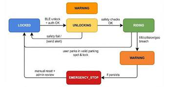

# Firmware notes

## The loop

`main.cpp` runs one loop 50 times a second. Each pass does the same eight steps in the same order (the order is from the prototype sketch):

| Step | Code | What it does |
|---|---|---|
| 1 | `IntentBox::drainInto` | Collects commands posted by the BLE and MQTT tasks. |
| 2 | `Sensors::update` | IR obstacle (moving average), throttle (dead zone), tilt (debounced), battery. |
| 3 | `SafetyController::evaluate` | Decides the allowed throttle and proposes a state. |
| 4 | `step` | Applies the proposal only if the transition table allows it. |
| 5 | `rampThrottle` | Moves the motor command one step towards the allowed value. |
| 6 | `motor::apply` | PWM output and lock servo. |
| 7 | `Ui::update` | LCD text and buzzer. |
| 8 | status out | Snapshot to the cloud task, BLE status at 5 Hz, alert on a new latched emergency. |

Steps 3 to 5 are pure functions of the `Context` struct and the current time, which is why they can be tested on a PC: the tests build a `Context`, call the same three functions in a loop, and assert on the result.

## Throttle path

The rider's throttle never reaches the motor directly:

```
potentiometer -> requestedThrottle -> allowedThrottle -> motorThrottle -> PWM
                 (dead zone)          (zone and state)   (ramp per tick)
```

The ramp rate depends on the state: +2 % per tick while riding (0 to 100 % in one second), -3 % per tick braking, -20 % per tick in an emergency (full speed to zero in five ticks, 100 ms).

## What was ported unchanged

State names and the transition table; the 3 s tilt latch and its recovery conditions; the soft obstacle stop; slow-zone cap and red-zone 3 s ramp; lock rules; the IR, tilt and throttle filters with their constants; ramp rates; LCD texts; the BLE service and characteristic UUIDs and the JSON status format; the pin numbers.

## What was changed, and why

Each of these is pinned by a host test.

1. **A stray `RESET` no longer cancels a later emergency.** The sketch kept the reset flag set if it arrived while nothing was latched; the next latched emergency would then clear itself as soon as the scooter was upright with the throttle released, without anyone pressing reset. The flag is now dropped unless an emergency is latched.
2. **An obstacle is honoured in `WARNING` too.** The sketch checked the IR sensor only in `RIDING`, so inside a red zone an obstacle was ignored.
3. **No dead end in `EMERGENCY_STOP`.** In the sketch a soft stop could lose its cause while a red zone was active and then never leave the state. The exit now depends only on "not latched and the path is clear", and a red zone only acts on a ride in progress.
4. **No `delay()` in the loop.** The sketch beeped with three 100 ms delays, freezing the safety loop for 300 ms. The beeps are now timed with `millis()`.

Also changed in structure, not behaviour: one module per file; time passed in as a parameter instead of calling `millis()` inside the rules; BLE callbacks post to an atomic mailbox instead of writing the shared struct from another task; the motor PWM is switched off before anything else in `setup()`.

## What was added

Marked `[new]` in `Config.h` and in the file headers. None of it ran on the prototype.

- Battery measurement through a divider, and the book's pre-ride rule "battery above 10 %" in `UNLOCKING`.
- A lock servo that follows the state (engaged only in `LOCKED`).
- A GPS sentence parser (NEO-6M style receiver on UART2).
- The cloud task: Wi-Fi and MQTT over TLS to AWS IoT Core, reconnects with exponential back-off, telemetry at 1 Hz in a ride and every 30 s parked, alerts with QoS 1, and a 32-record outbox so records produced while offline are sent after reconnecting.
- A task watchdog (2 s) on the control loop.

Three switches in `Config.h` (`BATTERY_SENSE_FITTED`, `GPS_FITTED`, `LOCK_SERVO_FITTED`) are off by default, which makes the firmware behave like the desk prototype: battery shown as 100 %, no position, no servo.

## Known gaps, left open

- **Unlock is not authenticated.** Any BLE central can write `UNLOCK`. The book describes a digital key checked by the scooter; a design for it is in TODO.md.
- **Lock-on-disconnect is asked once.** When the phone disconnects the firmware requests a lock, but if the throttle is not released at that moment the request is refused and not retried.
- **A soft stop resumes by itself.** When the obstacle disappears the scooter returns to `RIDING` and ramps back up if the throttle is still held.
- The tilt sensor in the book is a ball switch on a GPIO; the sketch (and this code) uses an ADXL345 accelerometer. See HARDWARE.md.

## The book's state diagram



*Figure 36 of the final book.* The book's figure shows "BLE unlock + auth OK" and "manual reset + admin review"; the surviving sketch has neither authentication nor an admin step, and this rewrite follows the sketch.
