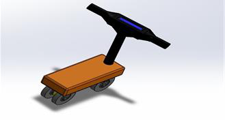
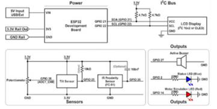

# Hardware

## The prototype that was built

The final book (ch. 6 to 8) describes a desk-sized scooter model, not a rideable vehicle: a small deck, a stem with a T-shaped handlebar, and small wheels that turn to show the motor command. It was built to test the electronics and the control logic safely on a table.

*Figure 33 of the final book: the mechanical model (team's work). This repository has no photograph of the built prototype.*

| Part | Role | Source |
|---|---|---|
| ESP32-WROOM-32 development board | Controller, Wi-Fi and Bluetooth | Book ch. 7.2, 8.2 |
| IR proximity module (digital output, active low) | Obstacle in front | Book ch. 7.3.2, sketch |
| Tilt sensing | Fallen or badly parked scooter | Book: ball tilt switch. Sketch: ADXL345 accelerometer on I2C |
| Rotary potentiometer | Stands in for the throttle | Book ch. 7.3.3, sketch |
| 16x2 character LCD with I2C backpack (address 0x27) | Rider display | Book ch. 8.2.2, sketch |
| Piezo buzzer | Warnings | Book ch. 7.4.2, sketch |
| Small DC gear motors with a driver, PWM from the ESP32 | "Wheels turn" feedback | Book ch. 6.4, sketch |
| Logic-level converter | 5 V parts on a 3.3 V controller | Book ch. 8.2 |

## Parts in the code that were not on the prototype

The firmware also supports three parts a real scooter would need. They were not bought for the prototype; the code for them is new, compiled and host-tested only, and switched off by default in `Config.h`.

| Part | Role | Code |
|---|---|---|
| NEO-6M GPS receiver (UART, 9600 baud) | Position in the telemetry record | `Nmea.cpp`, `CloudLink.cpp` |
| Lock actuator (hobby servo on a 50 Hz PWM) | Physical lock, engaged only in `LOCKED` | `Motor.cpp` |
| Battery divider (100 k / 8.2 k into an ADC1 pin) | Pack voltage and percentage | `Battery.cpp`, `Sensors.cpp` |

The divider values assume a 42 V pack and are placeholders.

## Pin map

The pin numbers in the surviving sketch differ from the pin map printed in the book. The code uses the sketch's numbers; the book's are listed for comparison.

| Signal | This code and the sketch | Book (ch. 8.3, figure 35) |
|---|---|---|
| I2C SDA / SCL (LCD, accelerometer) | GPIO 21 / 22 | GPIO 21 / 22 |
| Throttle potentiometer | GPIO 34 (ADC1) | GPIO 36 (ADC1) |
| IR obstacle module | GPIO 27 | GPIO 26 |
| Buzzer | GPIO 25 | GPIO 27 |
| Motor PWM | GPIO 26 | GPIO 14 ("motor simulation LED") |
| Tilt | ADXL345 on I2C | Tilt switch on GPIO 25 |
| Status LED | not used | GPIO 2 |
| Battery divider [new] | GPIO 35 (ADC1) | not in the book |
| Lock servo [new] | GPIO 13 | not in the book |
| GPS RX / TX [new] | GPIO 16 / 17 | not in the book |

Both versions keep the analog inputs on ADC1. The book explains why: the ESP32's second ADC shares hardware with the Wi-Fi radio and cannot be read while Wi-Fi is on.

*Figure 35 of the final book.*

## Before powering a real build

Not done here, listed so nobody skips them: the IR module and LCD backpack are often 5 V parts and need the level converter on their signal lines; a servo and motors must not be powered from the ESP32's 3.3 V pin; the battery divider must be checked with a multimeter before it is connected to an ADC pin.
